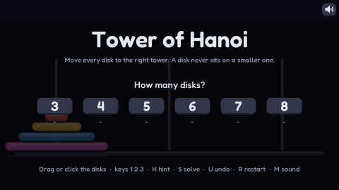
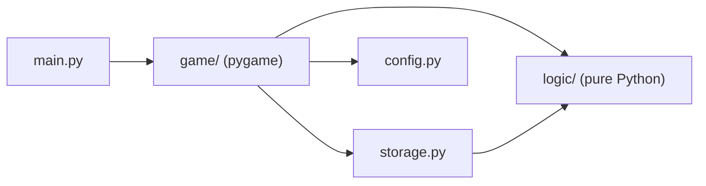

# Tower of Hanoi

[](https://github.com/rjrnova18-debug/hanoi-towers/actions/workflows/ci.yml)

A Tower of Hanoi game made with **pygame-ce**. It can give you a hint or finish the puzzle for you from **any** position, even after your mistakes, and it runs in the browser.

**▶ Play it in your browser:** https://rjrnova18-debug.github.io/hanoi-towers/ (click once to start; it also works on a phone).



It started as one of my first Python scripts, which had a bug. This repo rewrites it into a tested, playable game. The original script is kept untouched in [`legacy/`](legacy/hanoi_og_code.py).

## Features

- **3 to 8 disks.** Move them by dragging, by clicking two towers, or with the keys 1 2 3. Touch works on phones.
- **Hint (H):** shows the best next move from where you are now.
- **Solve (S):** plays the shortest solution from where you are now, animated. Press S again to stop it and take over.
- **Score:** moves against the minimum (2ⁿ − 1), a timer and stars: ★★★ optimal, ★★ within 1.5× the minimum, ★ any other win. A game where you used Hint or Solve still counts as solved, but it earns no stars and no record.
- **Records:** your best game for each number of disks is saved: in a file on the PC, in `localStorage` in the browser.
- **Undo (U)** and **Restart (R)**. An illegal move shakes the disk in red.
- **Sound** for picking, dropping, illegal moves and winning, with a mute button (or M) that is remembered.

## The bug in my first version

My original script had two solvers:

- **Iterative (written by me):** it cycles through pairs of towers and moves a disk between each pair. From the third move on, it chose the same tower as source and target. With 3 disks, 5 of its 7 moves were like "move disk 2 from B to B". It also used the same cycle of pairs for any number of disks, but the order must change when the number is even.
- **Recursive (generated by an AI):** correct, but the script never called it.

In this rewrite, a test runs the original file and checks that the bug is really there ([`tests/test_solver.py`](tests/test_solver.py)). The fixed `iterative_solution` is checked against the recursive one for 1 to 8 disks.

## How Hint and Solve work

The classic recursive solution only works from the starting position. To solve from **any** position, the solver looks at the **largest disk** first:

1. If it is already on the goal tower, leave it there and solve the smaller disks onto the same tower.
2. If not, move all the smaller disks out of the way to the spare tower, move the largest disk to the goal, and then solve the smaller disks onto it.

Hint is the first move of that sequence; Solve plays all of it. To make sure it is truly the **shortest** solution, a test compares it with a brute-force search (breadth-first search) over **every possible position** of 1 to 5 disks (363 positions).

## Run it

```bash
python -m venv venv
source venv/Scripts/activate      # Windows (Git Bash). On macOS/Linux: source venv/bin/activate
pip install -r requirements-dev.txt
python src/main.py
```

The web version, built with [pygbag](https://github.com/pygame-web/pygbag) (the same build that GitHub Actions publishes):

```bash
python -m pygbag src             # then open http://localhost:8000
```

Tests and lint:

```bash
pytest
ruff check . && ruff format --check .
```

## Project structure

```
src/
├── main.py                  # entry point (pygbag needs this exact name)
├── assets/                  # font (Fredoka) and sound effects
└── hanoi/
    ├── config.py            # every constant: sizes, colors, speeds, volumes
    ├── storage.py           # records and settings: a JSON file on the PC, localStorage on the web
    ├── logic/               # pure Python, no pygame
    │   ├── rules.py         #   towers, legal moves, solved?
    │   ├── solver.py        #   recursive, iterative (fixed) and solve-from-any-position
    │   └── session.py       #   one game: moves, undo, timer, assisted, stars
    └── game/                # everything that uses pygame
        ├── app.py           #   main loop, screen changes, crossfade, sound button
        ├── board_view.py    #   where towers and disks are, and how they are drawn
        ├── disk_motion.py   #   the disk that flies, shakes or bounces
        ├── animations.py    #   flight path, easing, bounce, shake, confetti
        ├── audio.py         #   sound effects and mute
        ├── widgets.py       #   buttons, text, stars, icons
        └── screens/         #   menu, play and win screens
tests/                       # one test file per module
legacy/hanoi_og_code.py      # my original script, untouched
.github/workflows/ci.yml     # lint + tests → web build → deploy to GitHub Pages
```

Imports only go one way. `logic/` never imports pygame, and a test fails if it ever does:



## CI/CD

Every push and pull request runs [GitHub Actions](.github/workflows/ci.yml) on a clean Linux machine:

```
lint-and-test  ──►  build-web  ──►  deploy
(every push/PR)     (only pushes to main)
```

The web version is only built and published if lint and tests pass, so a broken commit never reaches the live game.

## What I learned

- **Proving a bug before fixing it.** A test that runs my old script shows the bug, so the fix is checked against something real.
- **Testing an algorithm against brute force.** A slow but obviously correct search (BFS over every position) checks that the fast solver is optimal.
- **Keeping logic apart from the screen.** The rules, the solver and the game session are plain Python, tested without opening a window. pygame only draws and reads input.
- **Making code testable by passing things in.** The clock, the save location, the random numbers and the sound are given to the code instead of created inside it, so tests can use fakes.
- **How a game loop works.** Input → update → draw, sixty times per second, with animations as small objects that only compute where something is at a given moment.
- **Deepening a module.** Flying, shaking and bouncing disks were spread over two screens; moving them into one `DiskMotion` module made both screens simpler and the behaviour testable in one place.
- **Shipping Python to the browser.** pygbag compiles the game to WebAssembly. A bug that only happened in the browser (pygame was never downloaded, because `main.py` did not import it) taught me to debug there, with the browser console and an automated browser.
- **CI/CD with GitHub Actions.** Jobs chained with `needs:`, deploy only from `main`, and only the deploy job has permission to publish.
- **Git as a habit.** Small commits with clear messages (Conventional Commits), reviewed with `git diff` before each one.

## Possible improvements

- One "autoplay" module shared by Solve and the menu demo (both play a list of moves one by one).
- A browser smoke test in CI that opens the web build and fails on a Python error, since pytest cannot catch browser-only problems.
- Patterns on the disks, so they can be told apart without color.
- A four-tower variant (the Reve's puzzle), where the shortest solution is much harder to find.

## Credits

- **Font:** [Fredoka](https://fonts.google.com/specimen/Fredoka) by The Fredoka Project Authors, under the [SIL Open Font License](src/assets/fonts/OFL.txt).
- **Sound effects:** from [Pixabay](https://pixabay.com/sound-effects/), under the [Pixabay Content License](https://pixabay.com/service/license-summary/). Trimmed and converted to OGG for this game.

## License

The code is [MIT](LICENSE). The font and the sound effects keep their own licenses (see Credits).
